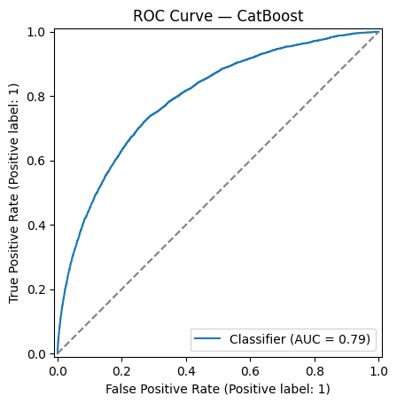
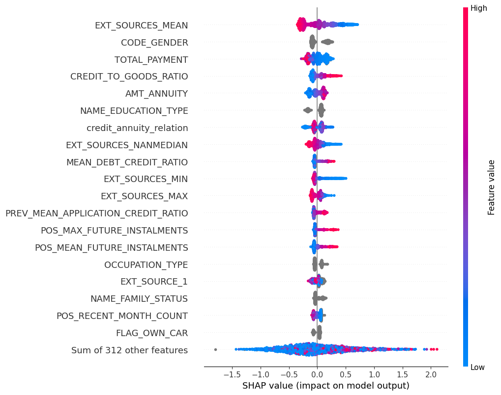

# Прогнозирование кредитного дефолта | Home Credit Default Risk

## О проекте

Цель проекта - предсказание вероятности дефолта по данным клиента: финансовое положение, социальный статус, кредитная история и т.д..

Проект выполнен на данных соревнования [Home Credit Default Risk](https://www.kaggle.com/competitions/home-credit-default-risk) на платформе Kaggle.

**Задача:** бинарная классификация.

**Целевая переменная:** `TARGET`, где:
- `0` - клиент не допустил дефолт;
- `1` - клиент допустил дефолт.

**Основная метрика:** ROC-AUC.

**Итоговый результат на локальной отложенной выборке: ROC-AUC = 0.79325.**

## Данные

Основная обучающая выборка содержит 307 511 наблюдений. Доля дефолтов составляет около 8,1%. То есть наблюдается сильный дисбаланс классов.

Помимо основной таблицы есть дополнительные источники:

| Таблица | Содержание |
|---|---|
| `application_train/test` | Информация о текущих заявках и заёмщиках |
| `bureau` | Кредитная история в других финансовых организациях |
| `previous_application` | История предыдущих кредитных заявок |
| `installments_payments` | Информация о запланированных и фактических платежах |
| `POS_CASH_balance` | Помесячные данные о предыдущих кредитах |
| `credit_card_balance` | История использования кредитных карт |

Таблица `bureau_balance` также рассматривалась, но была исключена, потому что в предварительном эксперименте её добавление не улучшило качество модели, а вычислительных затрат было много.

## Этапы работы

### 1. EDA

- Исследовано распределение целевой переменной и основных характеристик заёмщиков.
- Проверены гипотезы о связи дохода, возраста, кредитной нагрузки и других факторов с дефолтом.
- Использованы статистические критерии Манна-Уитни и хи-квадрат.
- Исследованы корреляции между признаками.
- Проанализированы пропуски и их связь с целевой переменной.

**Основные наблюдения:** более молодые заёмщики чаще допускают дефолт; внешние оценки демонстрируют заметную связь с целевой переменной; некоторые группы пропусков также информативны.

### 2. Feature Engineering

Созданы дополнительные признаки на основе основной и вспомогательных таблиц:

- Отношения финансовых показателей: дохода, суммы кредита, ежемесячного платежа и стоимости товара.
- Агрегированные характеристики внешних скоринговых оценок.
- Показатели долговой нагрузки и кредитной активности.
- Частота, продолжительность и величина просрочек.
- Характеристики предыдущих заявок и решений по ним.
- Показатели использования кредитного лимита.
- Признаки, характеризующие отсутствие информации.

Исторические данные агрегированы на уровне клиента и объединены с основной таблицей по `SK_ID_CURR`.

Дополнительно проверены корректность объединения, наличие дубликатов, пропусков и потенциальных временных утечек.

### 3. Обучение модели

Для решения задачи выбран **CatBoostClassifier**, позволяющий работать с категориальными признаками и пропущенными числовыми значениями.

Обучение включало:

- Сравнение модели на признаках основной таблицы и на всех таблицах.
- Стратифицированную 5-fold кросс-валидацию.
- Подбор гиперпараметров с помощью Optuna.
- Финальную оценку на локальной отложенной выборке.

Для разработки использовались 80% размеченных данных, оставшиеся 20% были выделены для итоговой оценки.

### 4. Результаты

| Эксперимент | Средний ROC-AUC (5-fold CV) |
|---|---:|
| Признаки основной таблицы | 0.76629 |
| Расширенный набор признаков | **0.78998** |
| Расширенный набор + Optuna | 0.78976 |

Добавление исторических данных позволило увеличить ROC-AUC на **0.02370**.

Подбор гиперпараметров не улучшил метрику на 5-fold кросс-валидации. Основной прирост качества был достигнут благодаря Feature Engineering.

**Результаты на локальной отложенной выборке:**

| Метрика | Значение |
|---|---:|
| ROC-AUC | **0.79325** |
| Average Precision | **0.29481** |
| Brier Score | **0.06522** |
| Brier Score константной модели | 0.07421 |

Значение Average Precision существенно превышает долю положительного класса (0.08073), который получился бы, если бы мы делали случайное ранжирование.

Brier Score модели ниже константного baseline примерно на 12,1%. Это означает улучшение качества вероятностных прогнозов.

### 5. Интерпретация

Для анализа предсказаний использовался SHAP.

Проведены:

- Анализ глобальной важности признаков с помощью SHAP Beeswarm.
- Исследование зависимостей SHAP от значений отдельных признаков.
- Объяснение индивидуальных прогнозов с помощью SHAP Waterfall.

Среди наиболее значимых для модели характеристик выделяются внешние скоринговые оценки, показатели кредитной нагрузки и история платежей.

Модель связывает низкие внешние оценки и высокую степень использования кредитного лимита с повышенным прогнозируемым риском дефолта.

Дополнительно исследованы ROC- и PR-кривые, калибровка вероятностей и зависимость ошибок классификации от выбранного порога.

## Структура репозитория

```text
home-credit-default-risk/
├── notebooks/
│   ├── 01_data_overview_and_eda.ipynb
│   ├── 02_feature_engeneering.ipynb
│   ├── 03_modeling.ipynb
│   └── 04_model_interpretation.ipynb
├── README.md
├── requirements.txt
└── .gitignore
```

**Описание ноутбуков:**

1. `01_data_overview_and_eda.ipynb` — обзор данных, EDA и проверка гипотез.
2. `02_feature_engeneering.ipynb` — создание признаков и объединение таблиц.
3. `03_modeling.ipynb` — сравнение моделей, Optuna и обучение.
4. `04_model_interpretation.ipynb` — оценка качества, калибровка и SHAP.

## Технологии

**Python**, Pandas, NumPy, Matplotlib, Seaborn, SciPy, Scikit-learn, CatBoost, Optuna, SHAP.


## Воспроизведение результатов

1. Скачать исходные данные со страницы [соревнования Kaggle](https://www.kaggle.com/competitions/home-credit-default-risk/data).
2. Установить необходимые библиотеки из `requirements.txt`.
3. Запустить ноутбуки в порядке их нумерации.
4. Передать файлы, сформированные на предыдущих этапах, в следующие ноутбуки.

Ноутбуки используют пути к выходным файлам Kaggle Notebooks. При запуске в другой среде необходимо изменить пути к данным.

Исходные датасеты, промежуточные CSV-файлы и обученные модели в репозиторий не включены.


## Выводы

В рамках проекта реализован полный цикл построения модели кредитного скоринга: от исследования данных и создания признаков до обучения, оценки качества и интерпретации результатов.

**Главный вывод:** использование исторических данных о кредитах, заявках и платежах улучшило качество прогнозирования по сравнению с моделью, использующей только характеристики текущей заявки.

Финальная модель CatBoost достигла ROC-AUC **0.79325** на локальной отложенной выборке.

Полученные результаты демонстрируют практическую ценность Feature Engineering и необходимость комплексной оценки модели не только по ROC-AUC, но и по качеству вероятностных прогнозов и характеру ошибок.